  

# Good morning, Night City

I'm Kamil, a fullstack developer from Szczecin,  Poland. I build internal tools for e-commerce teams: browser extensions, APIs, Figma plugins, and AI agents that handle the repetitive weekly work on their own. In my spare time I build **labsUI**.

🔗 **[kznlabs.com](https://kznlabs.com)** · ✉️ **contact@kznlabs.com**

### What I'm working on

- **Status:** Open to new projects, collaborations, and full-stack opportunities.
- **[labsUI](https://kznlabs.github.io/labsUI)**: accessible React components with one spring for every motion. Copy them in with a CLI or let your AI agent add them over MCP. WCAG 2.2 AA checked in CI across Chromium, Firefox and WebKit.
- **AI automation at work**: Claude Code agents and MCP servers that build and QA a weekly newsletter for 21 shops.
- **Main stack:** TypeScript, React, Next.js, Bun, ElysiaJS, WXT

---

### Tech stack

<strong>Languages & core</strong>

  

<strong>Frameworks & backend</strong>

  

<strong>DevOps & tools</strong>

  

<strong>Also worked with</strong>

  

  
<b>👀 Text version</b>

   
  <ul>
    <li><b>Languages:</b> TypeScript, JavaScript, HTML, CSS/Sass, Python</li>
    <li><b>Frameworks & backend:</b> React, Next.js, Tailwind CSS, Bun, Node.js, ElysiaJS, Express, WXT, MongoDB</li>
    <li><b>AI:</b> Claude Code, MCP servers, AI agents</li>
    <li><b>DevOps & tools:</b> Git, GitHub Actions, Docker, Linux (AlmaLinux), PM2, Turborepo, Vercel, Cloudflare, Figma plugins</li>
    <li><b>Also worked with:</b> Kotlin, Java, PaperMC, Gradle, Discord.js</li>
  </ul>

---

### Activity

  
    
  

---

### Let's connect

&nbsp;&nbsp;&nbsp;
&nbsp;&nbsp;&nbsp;

